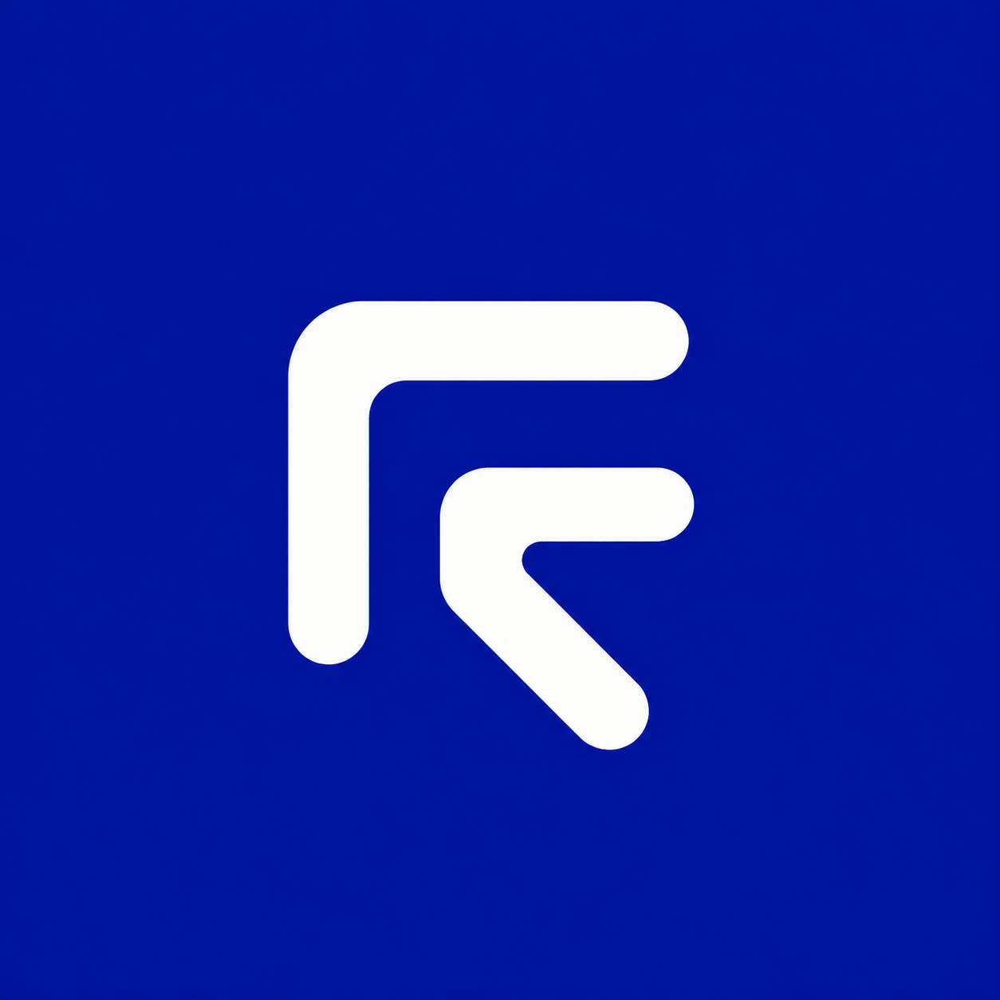
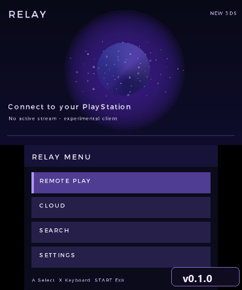
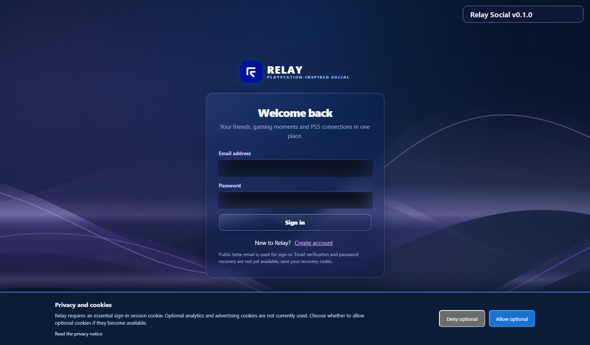

  

  # RELAY

  **A PlayStation-inspired remote play experience, built for more than one screen.**

  Native interfaces · Device-aware controls · Console discovery · Experimental platforms

  [Overview](#overview) · [Platforms](#supported-platforms) · [Preview](#animated-interface-preview) · [Relay Social](#relay-social) · [Roadmap](#development-roadmap) · [Credits](#credits-and-licensing)

  ---

  **Development status:** Public source · Experimental builds · Feature verification varies by platform

## Overview

Relay is an independent PlayStation Remote Play project with a custom PlayStation Portal-inspired interface. The Android application is the main feature and design reference. Additional platforms use their own rendering and input layers rather than merely repackaging an Android APK.

The goal is a coherent Relay experience across phones, tablets, foldables, gaming handhelds and television devices, with targeted native ports for systems that require different SDKs and hardware capabilities.

> **Important:** A platform appearing in the source tree does not mean it can currently stream games. Menu rendering, connection establishment, live video, game audio and controller forwarding are separately tracked milestones. Relay is unofficial and is not affiliated with Sony Interactive Entertainment.

## Animated interface preview

  
  
  
Nintendo 3DS family · v0.1.0 · Real Azahar UI capture · Game streaming not implemented in this preview

Future platform releases will include one matching version-numbered menu image and one actual menu-animation GIF per released target, updated whenever the interface changes significantly. Screenshots are captured from the application or emulator; unverified mockups are not release evidence.

## Supported platforms

| Platform | Build type | Status | Notes |
| :--- | :--- | :--- | :--- |
| Android phones, tablets and foldables | APK · ARM64 | **Core development** | Primary Remote Play and UI codebase; verify exact feature and console support per build |
| Android TV, Google TV, NVIDIA Shield | APK · ARM32/ARM64 variants | **Device-specific builds** | Landscape, D-pad/remote focus and decoder capabilities vary by hardware |
| Sony BRAVIA 8 II | Google TV APK | **Experimental** | Dedicated Google TV profile; real-TV compatibility not yet confirmed |
| AYN Thor and compatible Android dual-screen devices | APK · ARM64 or universal multi-ABI | **Experimental** | Main scene on the primary display; controls and keyboard on the lower display where the OS exposes it separately |
| Nintendo 3DS XL / New 3DS XL | `.3dsx` · ARM11 | **Menu verified in emulator** | Both Azahar hardware profiles render; top menu animation and bottom touchscreen navigation; **no Remote Play streaming** |
| PS Vita / PlayStation TV | `.vpk` · VitaSDK | **Native preview** | Animated native shell; network streaming, sound and inputs need independent integration |
| Nintendo Switch | `.nro` / `.nsp` | **Experimental native port** | Menu and input work underway; real game streaming unverified |
| Windows / ROG Ally / Steam Deck | Native desktop packages | **Work in progress** | Different packaging and controller modes |
| Xbox, Apple, Roku, Samsung Tizen, Meta Quest | Native/web-based platform prototypes | **Research / experimental** | Platform compatibility varies; not interchangeable with Android APKs |

Only **validated release-configuration artifacts** appear in [GitHub Releases](../../releases). Debug builds, development-only APKs and unverified menu builds are never public release assets. For detailed capability gates, see [platform validation](RELAY_BUILD_PARITY_MASTER.md).

## Interface and user experience

| Component | Intended Relay behavior |
| --- | --- |
| Main menu | Deep-blue/violet layered scene with an animated orb and console status |
| Controller navigation | D-pad/analog focus, select/back, context-sensitive quick menu |
| Keyboard | PlayStation-inspired text entry with numbers, QWERTY, symbols and visible focus |
| Dual-screen mode | Main scene and future stream on the upper/primary display; menus and keyboard on the lower/secondary display |
| Console selection | Discover and select owned, authorized compatible consoles; capabilities depend on target build |
| Game translation | Android-side optional OCR and translation experiments, with separate per-platform support requirements |
| Update delivery | Platform/ABI-aware verified packages and explicit approval for installation when required |

### Supported consoles and pairing

Standard PlayStation Remote Play and experimental authorized-homebrew connection paths are separate modes. Traditional pairing requires the account and console prerequisites supported by the underlying Remote Play protocol. Experimental host integrations require explicit owner approval and should never disclose a console's private network address or access token.

For the current feature boundaries, see [the main build tracker](RELAY_BUILD_PARITY_MASTER.md). Console pairing screens and setup flows are still under active validation on several ports.

## Relay Social

Relay Social is a companion experience under development. Its design includes profiles, friend requests, presence, an activity feed, account setup and opt-in console linking. Planned pairing presents an owner-approved console connection flow rather than granting access merely because someone knows a profile name or friend code.

  
  
Relay Social v0.1.0 · Current development sign-in interface · No private credentials shown

Friend codes are discovery identifiers, **not authorization tokens**. Any public-facing demonstration of a friend code or console QR flow will mask the actual code completely. Account creation, primary-profile matching, owner-approved console pairing, friends, private messages, spectating and multiplayer invitations remain subject to their individual security and functionality checks. Social URLs are deliberately not published here.

Relay Social is maintained separately from this repository. Its live server, private database, secrets, account records and user media are **not part of the Relay source checkout**.

## Development roadmap

| Stage | Priority | Goal | Current state |
| --- | --- | --- | --- |
| Foundation | P0 | Shared Relay design language, build tracking, original console UI, provenance | **In progress** |
| Android stability | P0 | Console registration, stable video/audio, controller mapping, recovery | **Active development** |
| Native platforms | P0 | Platform SDK builds, input parity, legitimate menu/audio/rendering | **3DS emulator UI verified; other ports partial** |
| Dual-display | P1 | Main screen stays clear while the secondary display hosts menus and keyboard | **Experimental Android/3DS implementations** |
| Release automation | P1 | Monotonic versioning, weekly verification, platform-specific signed/release packages | **Workflow configured; release gated by evidence** |
| Relay Social | P1 | Secure account, friend code, opted-in console linking and profile management | **Companion project in development** |
| Shared sessions | P2 | Owner-approved invitations, spectating and multiple gamepad slots | **Research and prototypes** |
| Accessibility | P2 | Translation, legible overlays, controller-first operation, language options | **Partial / per-platform** |

See [GitHub milestones and work tracking](RELAY_BUILD_PARITY_MASTER.md) for the latest implemented and unverified details.

## Releases, compatibility and versions

- Version tags follow `relay-vMAJOR.MINOR.PATCH`, beginning at `relay-v0.1.0` and increasing monotonically.
- The same release version applies to every platform in that release, while **only eligible targets** receive downloadable assets.
- Verified weekly builds are evaluated **Monday at midnight, America/New_York**; a run without eligible source updates does not create a duplicate release.
- Release pages state supported models, architecture, dependencies, tested functionality, known limitations, installation instructions and SHA-256 checksums. Releases also include matching version-labeled images and animated menu GIFs.
- No untested ports, debug APKs or dummy binaries are published to Releases.

Full policy: [Master GitHub Rules](master%20girlthubrules.md) and [Release Validation](docs/release-validation/eligible-targets.json).

## Building and contributing

The core Android module uses the Android SDK, Gradle, the NDK and the Chiaki protocol libraries. Native ports have separate toolchain requirements, including VitaSDK and devkitPro for handheld consoles. Use [build instructions](build.md) and the applicable file under `platforms/`, then run source/parity checks before making compatibility claims.

Changes should preserve the shared interface while respecting the capabilities of each target. Contributors should review [contributor guidance](CONTRIBUTOR_GUIDE.md), [platform parity rules](RELAY_BUILD_PARITY_MASTER.md), [security expectations](SECURITY.md) and the source license. We welcome reproducible bug reports with exact model, OS/firmware, build hash and non-sensitive logs.

## Credits and licensing

Relay is based on and extends open-source work including [Chiaki](https://github.com/thestr4ng3r/chiaki) and [chiaki-ng](https://github.com/chiaki-ng/chiaki-ng). See [CREDITS.md](CREDITS.md) for libraries, framework acknowledgments, upstream repositories and research-source distinctions. Existing open-source licenses, copyright notices and third-party license files remain authoritative.

**Trademark notice:** PlayStation, PlayStation Portal, PS3, PS4 and PS5 are trademarks of their respective owners. This is an independent project, not an official Sony product. Nintendo, Xbox and other device names identify compatibility targets only.
